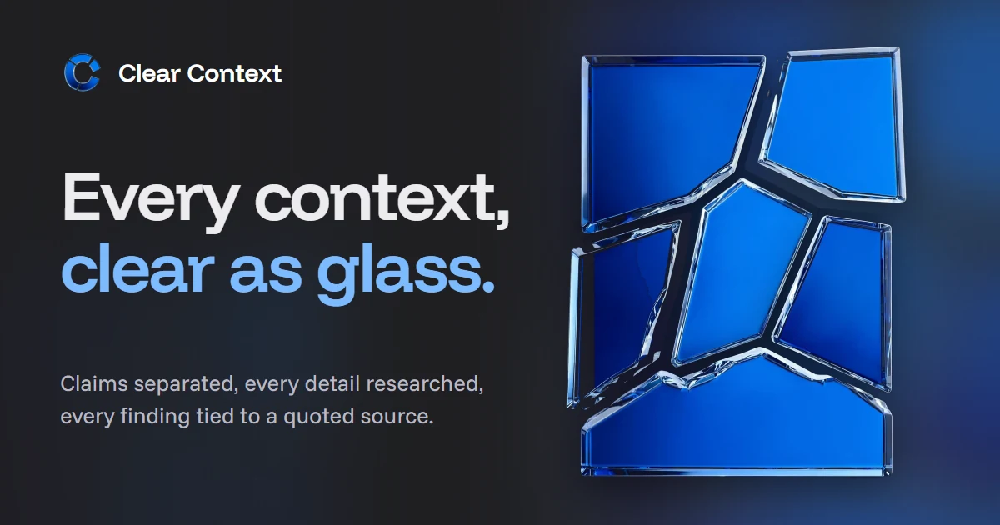
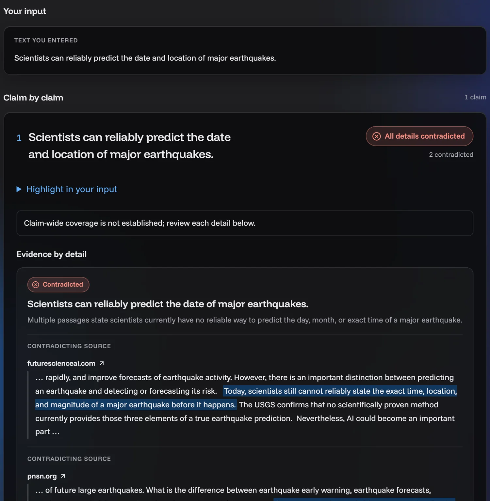
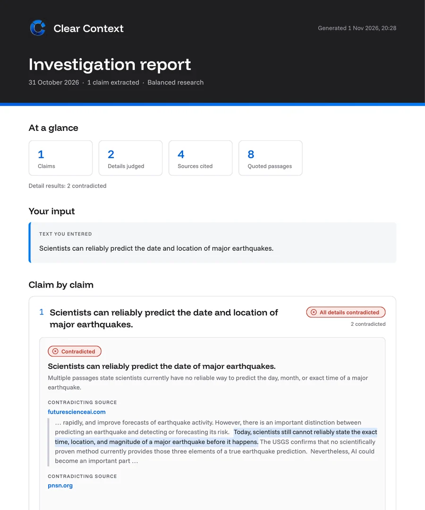
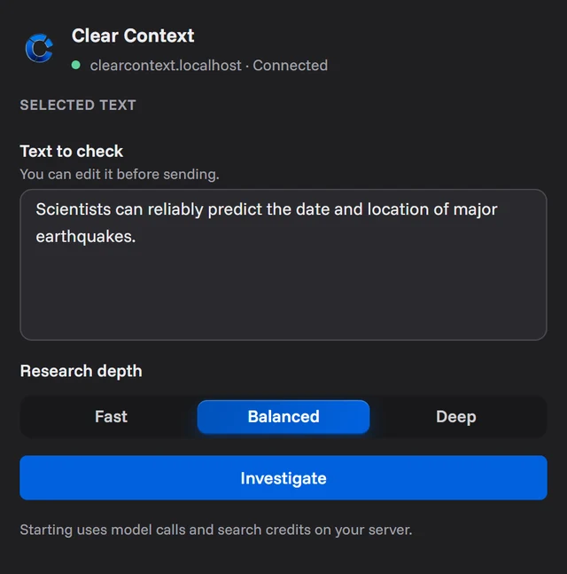
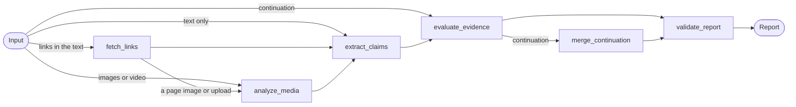
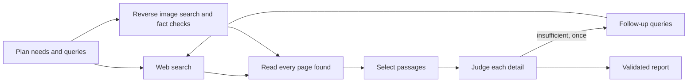

<p align="center">
  
</p>

<p align="center">
  <b>A self-hosted fact-checking agent built with Meta Muse.</b><br>
  It separates a post into claims, researches each detail, and shows the source passage every finding rests on.
</p>

<p align="center">
  <a href="https://clearcontext.uslanozan.com.tr"><b>Website</b></a> ·
  <a href="https://clearcontext.uslanozan.com.tr/demo/"><b>Live demo</b></a> ·
  <a href="https://clearcontext.uslanozan.com.tr/under-the-hood/"><b>Under the hood</b></a> ·
  <a href="#quick-start"><b>Quick start</b></a> ·
  <a href="#chrome-extension"><b>Chrome extension</b></a>
</p>

<p align="center">
  
  
  
  
  
  
  <a href="LICENSE"></a>
  <a href="https://github.com/uslanozan/Clear-Context/actions/workflows/ci.yml"></a>
</p>

| The report | The PDF | The Chrome extension |
| --- | --- | --- |
|  |  |  |

<sub>A recorded run on "Scientists can reliably predict the date and location of major earthquakes." (balanced research, Meta Muse Spark 1.3).</sub>

## Why

An event can be real while its photograph comes from another place or year. A statement can quote a source accurately while leaving out the condition that changes its meaning. A single true-or-false stamp hides both. Clear Context shows the evidence for each part of a claim, and says plainly where the investigation stays unresolved.

Clear Context was started solo for the **Meta Global AI Developer Hackathon** (October 26 – November 4, 2026) and is maintained as an open-source project.

## Quick start

To look around first, the [live demo](https://clearcontext.uslanozan.com.tr/demo/) shows recorded reports without installing anything; it is read-only and checks nothing new.

Pick one way to run it. All three keep your reports on your own computer.

**Desktop app (Windows, macOS, Linux).** Download the archive for your system from the [latest release](https://github.com/uslanozan/Clear-Context/releases/latest), unpack it and start **Clear Context** in the unpacked folder. A small window shows the address and your browser opens the app at `http://127.0.0.1:8765`; closing the window stops it. Nothing else needs to be installed. The app is not signed, so the first start shows a warning: on Windows choose **More info** and **Run anyway**; on macOS use **Open Anyway** under System Settings > Privacy & Security. The `README.txt` in the archive covers this, where your data is kept and how to remove it.

**Docker with the published images.** Requires Docker with Compose v2.24 or newer.

```bash
git clone https://github.com/uslanozan/Clear-Context.git
cd Clear-Context
docker compose -f compose.yaml -f compose.ghcr.yaml up -d
```

**Docker, built from source.** Same requirements; this builds both images on your machine:

```bash
git clone https://github.com/uslanozan/Clear-Context.git
cd Clear-Context
docker compose up -d --build
```

With Docker, open **http://clearcontext.localhost**. Then, whichever way you started it:

1. Open **Settings** and add a Meta Model API key for Muse; Tavily, SerpApi and Google Fact Check keys add web research, reverse image search and published fact checks. See [API keys and cost](#api-keys-and-cost) for where to get each one. Docker users can also put the keys in a `.env` file (copy `.env.example`) before starting.
2. Turn on **Allow paid calls**. Until then the app runs in preview mode and makes no model or search calls.
3. Optional: load the Chrome extension ([below](#chrome-extension)).

Your reports stay in a local SQLite database. The inputs and evidence of an investigation are sent to Meta and to the search services you enable; this is not offline inference. No account or subscription is involved, and a Muse Code subscription is not required.

## API keys and cost

Only the Meta key is required. The others are optional; without them the matching step is skipped or, for Tavily, runs on rate-limited keyless access. Each field in **Settings** links to the page where its key is created.

| Key | Used for | Where to get it |
| --- | --- | --- |
| Meta Model API (`META_API_KEY`) | Every model step: claims, images, video, research planning and evidence judgment | Create an API key in the [Meta developer dashboard](https://dev.meta.ai/). Billing is pay as you go, per token. |
| Tavily (`TAVILY_API_KEY`) | Web search and page reading | Sign up at [app.tavily.com](https://app.tavily.com/). The free plan includes monthly credits. |
| SerpApi (`SERP_API_KEY`) | Optional reverse image search with Google Lens and Bing | Copy the key from [serpapi.com/manage-api-key](https://serpapi.com/manage-api-key). The free plan has a monthly search allowance. |
| Google (`GOOGLE_FACT_CHECK_API_KEY`) | Optional published fact checks of an image | In Google Cloud, enable the [Fact Check Tools API](https://console.cloud.google.com/apis/library/factchecktools.googleapis.com) and create an API key. The API is free. |

**What a run costs.** Every report shows an estimated model cost under **Model usage**, counted from the recorded tokens at the catalog's list prices. A balanced run on the earthquake sentence above used 49,968 input and 10,127 output tokens with Muse Spark 1.3, about **$0.10** at the prices checked on November 10, 2026. Fast research makes fewer calls and Deep more; long texts, images and video add calls. Search services bill on their own plans, and the estimate leaves them and speech transcription out. Meta's [spend alert](https://dev.meta.ai/help/billing/spend-limit-alert) sends an email but does not stop requests.

## Measured accuracy

On 30 short claims with known answers (10 true, 10 false, 7 with one wrong detail, 3 that no source can settle; 20 in English, 10 in Turkish), one balanced run each with the default settings gave **28 correct, 2 unsettled and 0 wrong** results. No true claim was contradicted and no false detail was supported; for every half-true claim the contradicted detail was the wrong one. The two unsettled claims lost a correct judgment because the citation check rejected quotes that differed from the page only by a non-breaking space or a line break; 1.0.0 fixes this, and the figures above are from before the fix. The run cost $1.40 in model calls, about $0.05 and 45 seconds per claim.

These are well-known facts, run once with one model: the result shows the method works on simple claims, not how it does on long posts, recent events, images or video. Cases, rules and per-claim results are in [evals/accuracy-v1](evals/accuracy-v1/README.md).

## What it does

| | |
| --- | --- |
| **Input** | Text up to 20,000 characters, up to three links inside it, and up to four images or videos, from the web app or the Chrome extension. Nothing is sent until you press **Start investigation**. |
| **Claims** | A Muse model separates the input into claims in their original wording, with exact quote positions, and splits them into details a source can settle. Opinions and experiences only the author could know are reported as not researched. |
| **Research** | Searches are planned per detail and run through Tavily. Every readable page is read within a budget (Fast, Balanced or Deep), passages are selected, and each detail is judged only against recorded passages. Unsettled details get one follow-up round. |
| **Images** | Muse reads visible text and compares the picture with its caption (a labeled visual assessment, never evidence). Optional reverse image search (Google Lens and Bing through SerpApi) and published fact checks find where the same picture appeared. What a picture is said to show is settled only by pages showing the same picture. |
| **Video** | MP4 up to 50 MB and 10 minutes: speech is transcribed with Muse Voice Transcribe, a Muse model reads the frames with that transcript, and three frames are searched like images. |
| **Links** | The first 3,000 characters of each page are checked like pasted text, and its main image goes through the image checks. On X, Threads, Facebook, Instagram and TikTok only the post is kept: view counts, replies, comments and menus are dropped, avatars are not taken for the post's picture, and a page that shows only a login wall counts as unreadable. A publication date is shown only when a news index reports one for that page. |
| **Report** | Each detail is supported, contradicted, disputed, insufficient or not assessed, with quotes inside their page text. The claim label ("Mostly supported", "Mixed results") is counted from those results, not asked of a model. Every step shows what it recorded. Export as a Clear Context PDF or JSON. |
| **Extension** | Captures selected text, a link, an image or video frame, or an area of a page, previews it, and opens the web report. It finds your server by itself. |

## How it works

1. Submit text, links or media in the web app, or capture them with the Chrome extension.
2. Claims keep their original wording and are split into details such as dates, places and qualifications.
3. The investigation plans searches per detail, reads sources within the chosen depth, and keeps exact passages.
4. The report ties every finding to quoted passages and links, and shows what stayed unsettled and which steps failed.
5. Details the budget did not reach can be researched later as a continuation, or the whole report can run again in Deep.

Finding no supporting source is not evidence that a claim is false. Textual claims and image context are evaluated separately.

## Under the hood

### Meta models

Every model call goes to the Meta Model API with the server's own key. Muse Spark 1.3 is the default for each task; Settings can switch a task to another catalog model (Muse Wonder 1.0 or Muse Spark 1.1-1.3), and contributor models stay hidden unless training use is allowed.

| Step | Model | What the call returns |
| --- | --- | --- |
| Claim extraction | Muse Spark 1.3 | Claims in their original wording with exact character positions, split into details a source can settle. Long input is cut into bounded chunks. |
| Image and video reading | Muse Spark 1.3 (multimodal) | Visible text, observations and how the picture fits its caption, labeled as a visual assessment, never as evidence. A video's frames are read together with its transcript. |
| Speech | Muse Voice Transcribe 1.0 | Timed speech turns from a video's audio; noise that the model put words to is filtered out. |
| Research planning | Muse Spark 1.3 | Information needs per detail and the search queries that answer them, including which needs only same-picture pages can settle. |
| Passage selection | Muse Spark 1.3 | The IDs of the paragraphs of each read page that bear on a need, up to ten pages at a time. |
| Evidence judgment | Muse Spark 1.3 | A result per detail (supported, contradicted, disputed, insufficient) that cites recorded passage IDs only. |
| Follow-up planning | Muse Spark 1.3 | New queries for details left insufficient, once per investigation. |

Each text call asks for a JSON Schema response (`response_format: json_schema`) and is validated with Pydantic before anything is stored; a research plan that fails validation is asked for once more, and every call's token usage is recorded with the report. The claim label above the details ("Mostly supported", "Mixed results") is counted from the detail results, not asked of a model.

### Agent orchestration with LangGraph

An investigation is a compiled LangGraph `StateGraph` ([graph/investigation.py](backend/src/clear_context/graph/investigation.py)) over a typed state ([graph/state.py](backend/src/clear_context/graph/state.py)). Conditional edges choose the path from the input: links are read first, their images join uploaded media, and a continuation skips straight to research.



The graph runs with a recursion limit and is streamed node by node; every update is written to SQLite as a recorded step, which is what the web app and the extension show as progress. Nothing in the progress view is estimated. The nodes are focused steps of one bounded workflow, not independent agents that negotiate with each other.

`evaluate_evidence` runs the research loop for every detail ([services/investigation_research.py](backend/src/clear_context/services/investigation_research.py)):



Research depth sets the call limits, not the method:

| Depth | Queries | Pages read | Passage calls | Judgment calls | Follow-up round |
| --- | --- | --- | --- | --- | --- |
| Fast | 3 | 12 | 12 | 4 | none |
| Balanced | 6 | 20 | 20 | 6 | 2 queries, 10 pages |
| Deep | 10 | 30 | 30 | 10 | 4 queries, 15 pages |

Details the budget did not reach are listed as such and can be researched later as a linked continuation, which runs the same graph on those details and merges the results into a new report.

### Grounding checks

- A claim's quote must match the input at its saved character positions; `validate_report` rejects the report otherwise.
- Passage selection returns paragraph IDs from the page's own text, so a passage is always the page's wording, never the model's. A judgment's schema lists only the passage IDs recorded for that detail as allowed values, so it cannot cite anything else.
- The page being checked is never evidence for itself, and a fact-check rating is shown as the publisher's, not adopted as the verdict.
- What an attached picture or video shows (its place, time or event) is settled only by pages that show the same picture; a web search for the event cannot settle it.
- Mock mode, the default, makes no model or search calls, and paid calls need an explicit setting plus a button press for every investigation.

### External services

| Service | Used for |
| --- | --- |
| Meta Model API | Chat completions for every Muse step above, and speech transcription. |
| Tavily Search and Extract | Web search, page reading, reading the links in the input, and the publication date a news index reports for a linked page. |
| SerpApi (optional) | Reverse image search through Google Lens and Bing. |
| Google Fact Check Tools (optional) | Published fact checks of the same image or its caption. |

Set `TAVILY_API_KEY` to use your own Tavily account (the free plan includes monthly credits); without it, research falls back to keyless access, which is rate-limited without a published quota and stopped repeated or Deep runs in testing. No paid fallback runs automatically. Connection errors, dropped connections and 429 and 5xx answers are retried twice with a short wait, honouring Retry-After up to 20 seconds. A dropped connection on a paid Meta call may already have been billed and is still repeated, so an investigation does not fail on a transient drop; a paid call is not repeated after a timeout. If research planning still fails, the report keeps the extracted claims and says they were not researched. Reverse image search is optional: set `REVERSE_IMAGE_PROVIDER=serpapi_lens` and `SERP_API_KEY` (SerpApi's free plan has a monthly search allowance; each image uses an upload and one or two searches). Images are then sent to SerpApi and Google. Match dates are the dates Google Lens shows for each page, not verified first-publication dates. With a Google API key, published fact checks are looked up through the free Google Fact Check Tools API. Users must confirm their own billing or credit availability before enabling paid inference.

### Stack

- **Backend:** Python, FastAPI, Pydantic, LangGraph, httpx; SQLite through SQLAlchemy with Alembic migrations; PyAV for playable video copies. Prompts and method catalogs live in `config/*.yaml`.
- **Frontend:** React, TypeScript, Vite, Mantine with one shared theme, TanStack Query, and react-pdf for the PDF export.
- **Extension:** Chrome Manifest V3, built from the same theme and types as the web app.
- **Packaging:** Docker Compose serves the API and web app on one local address, with the database and uploads in a volume.

More detail: [architecture and evidence contract](docs/ARCHITECTURE.md), [text analysis](docs/TEXT_ANALYSIS.md), [evidence judgment](docs/EVIDENCE_JUDGMENT.md), [prompt settings](docs/PROMPTS.md) and [retrieval evaluation](evals/README.md#retrieval-workspace-evaluation-runner).

## Known limitations

- **No verdict on truth.** The report shows what recorded sources say about each detail. No supporting evidence is not evidence that a claim is false, and evidence assessments do not establish source reliability; the source type (fact check, reference, social, web) describes a page, it does not rate it.
- **Models can be wrong.** An exact quote match proves only that the sentence is on the page, not that a model read its meaning correctly. Semantic completeness of claim extraction is not established, and a claim's label covers only the details that were checked. The [measured accuracy](#measured-accuracy) comes from a small set of simple claims.
- **Image and video provenance is limited.** Visual inspection cannot establish an image's date, location or authenticity, and there is no AI-generated-image or deepfake detection. Lens dates are the dates shown for a page, not verified first publication. Videos from platform links (YouTube, X, Instagram) are not downloaded; capture a frame or an area instead.
- **Dates and language.** Source language is inferred by the model; a publication date is known only when a news index reports one.
- **Some social links cannot be read.** Pages are read by Tavily's servers, never by yours. In testing on November 2, 2026, Instagram and Reddit posts came back empty and TikTok returned a regional notice instead of the post, so these links are reported as unreadable; X, Threads and public Facebook posts were read. For an unreadable post, paste its text or capture it with the extension's **Capture an area**, which takes what you see on screen.
- **Research depends on third parties.** Without a `TAVILY_API_KEY`, search uses keyless access, which is rate-limited and stopped repeated or Deep runs in testing. Reverse image search is off by default and sends images to SerpApi and Google.
- **Not a hosted service.** The app has no authentication and binds to loopback; do not expose it to an untrusted network. Run one server instance per database. A running investigation cannot be cancelled, and graph checkpoints are not implemented: after a restart, queued investigations run again and running ones are marked failed as interrupted.
- **Not implemented:** adding a correction or a source of your own to see which findings change, a per-user trusted-source list, and a statistics page across reports.
- **Clients.** The web app is responsive but not an installable PWA. The desktop app is a local server that opens in your browser, not a native window, and it is not signed, so Windows and macOS warn on its first start. The extension is for Chrome, is not on the Chrome Web Store, and is loaded unpacked. PDF export leaves emoji out of quotes (the JSON keeps the exact text).
- **Evaluation.** The accuracy set has 30 simple claims run once with one model; its result is not a benchmark.

## Chrome extension

The extension sends something from the page you are reading to your own Clear Context server and opens the web report. It does not show reports itself.

It ships ready to load, with no build step: unzip `Clear-Context-chrome-extension.zip` from the [latest release](https://github.com/uslanozan/Clear-Context/releases/latest), or use the `chrome-extension` folder of a clone. Open `chrome://extensions`, turn on **Developer mode**, choose **Load unpacked** and select that folder. After an update, press the reload button on its card in `chrome://extensions`. The source is in `frontend/extension/`; developers rebuild the folder with `npm run build:extension` in `frontend/` and check it with `npm run check:extension`.

<details>
<summary><b>Ways to capture, and what the extension does</b></summary>

- **Selected text:** select text, right-click and choose **Check with Clear Context** (or use **Use selected text** from the toolbar button). Only the text in the box is sent; to have a post or article read, paste its link into the text.
- **An image or a video frame:** right-click it and choose **Check with Clear Context**. The picture is cut from a screenshot of what you see, so it works on pages that need a login. For an image, **Use the original image file** fetches the file the page published, after you grant access to that one site; reverse image search matches it better than an enlarged screenshot.
- **An area:** toolbar button, **Capture an area**, then drag over anything on screen, such as a post or a paused video.
- **A link:** right-click a link and choose **Check this link with Clear Context**, or paste text or a link (for example a post's address copied from the address bar) into **Paste text or a link** in the toolbar button and press **Continue**. The link appears in the box as text; the server reads it like a link typed into the web app.

A window then shows what was captured, lets you edit the text, choose the research depth and press **Investigate**; nothing is sent before that, and a failed request keeps the capture. It then shows the steps the server records and, when the report is ready, a short summary: each claim with the count of its supported, contradicted and unsettled details, and for a picture the earliest page found with the same picture and caption details it does not fit. The evidence itself stays in the web report (**Open report**). The extension finds the server itself, with no setting: it tries the address that worked last time, Clear Context tabs you have open (so any port works once you have opened the app in that browser), then `http://clearcontext.localhost` (Docker), `http://127.0.0.1:8765` (desktop app) and `http://clearcontext.localhost:5173` (development). When nothing answers it says so and offers **Check again**. The API key stays on the server; original image files ask for permission to the image's site when used. Videos on platforms such as YouTube or X are not downloaded; capture a frame or an area instead.

</details>

## Settings

The **Settings** page in the sidebar changes the most common settings without editing `.env` or restarting:

- **API keys** for Meta, Tavily, SerpApi and Google Fact Check Tools. Keys are write-only: the page shows whether a key is set, where it comes from and a preview such as `LLM_ab12...wxyz` (first eight and last four characters for keys of 24 characters or more, only the last four for 16 to 23, nothing for shorter keys), never the whole key. To change a key, enter it again.
- **Models** for claim extraction, image reading, research planning and evidence judging. Only catalog models allowed for text investigations are offered; contributor models stay hidden while `MODEL_ALLOW_TRAINING_USE=false`.
- **Allow paid calls**, behind a confirmation. It switches between preview mode and live mode (Meta calls plus source research) and needs a Meta key. Saving a key never turns paid calls on by itself, and investigations still start only from an explicit button press.
- **Advanced settings** (collapsed): default research depth, reverse image search, fact check search, link reading and the search score threshold.

`.env` seeds these settings: when the server starts, every one of them that has no saved value yet is copied from `.env` into the SQLite database (the Docker data volume). From then on the database is the source, and changes apply from the next investigation; investigations already running finish with the settings they started with. Empty keys are not stored, so a key added to `.env` later is picked up at the next start. Editing any other value in `.env` later does not replace the saved one: the page marks it **Saved here · differs from .env**, and **Use .env value** copies the current `.env` value on save. **Reset all to .env**, behind a confirmation, does this for every field at once. Keys are stored as plain text, like `.env`, so keep the database private. Saved values that the server cannot use at start-up are reported on the page while the server runs with `.env`.

## Run with Docker

<details>
<summary><b>Ports, data volume, importing an older database, and network exposure</b></summary>

Requires Docker with Compose v2.24 or newer. From the repository root:

```powershell
# Copy only when creating your local settings; preserve an existing .env.
# Copy-Item .env.example .env
docker compose up -d --build
```

Open `http://clearcontext.localhost` (or `http://127.0.0.1`). Chrome, Edge and Firefox resolve every `*.localhost` name to this machine, so no hosts-file or DNS change is needed; other browsers may need `http://127.0.0.1`. The `web` container serves the built interface on port 80 and proxies `/api` to the `api` container, which applies database migrations before starting. Settings come from `.env` and the [Settings page](#settings); the container overrides only the bind address, the database path and CORS. Mock mode stays the default, and the paid-call settings described below apply unchanged.

Both SQLite databases (investigations and research cache) live in the `clear-context-data` volume and survive `docker compose down` and image rebuilds. `docker compose down -v` deletes them. The volume starts empty. To bring over reports from a non-Docker setup, stop the local API, then run:

```powershell
docker compose stop api
docker compose run --rm --no-deps -v "${PWD}/.local:/import:ro" api python -m clear_context.db.import_local /import/clear-context.db
docker compose start api
```

The command copies `clear-context.db` and the `research.sqlite` cache beside it with SQLite's backup API, refuses to overwrite a volume that already holds data unless you add `--replace`, and refuses a source with an unfinished journal. Pending migrations run when the API starts. In Git Bash, prefix the `run` command with `MSYS_NO_PATHCONV=1` so `/import` is not rewritten.

The published port binds to loopback because the application has no authentication. Set `CLEAR_CONTEXT_PORT` if port 80 is taken (for example `8080`, then open `http://clearcontext.localhost:8080`). The API answers only to the host names in `ALLOWED_HOSTS` (default `localhost`, `127.0.0.1` and `*.localhost`), which stops other websites from reaching it through DNS rebinding. Changing `CLEAR_CONTEXT_BIND` exposes the app to your network without access control or HTTPS; do not do that on an untrusted network. Interactive API documentation is available at `http://clearcontext.localhost/docs` (and `/redoc`) unless `API_DOCS_ENABLED=false`.

</details>

## Development

<details>
<summary><b>Run the backend and web app without Docker, paid-call settings, research budgets and checks</b></summary>

Python 3.12 or newer is required. From the repository root on Windows PowerShell:

```powershell
python -m venv .venv
.\.venv\Scripts\python.exe -m pip install -r backend/requirements-dev.lock
.\.venv\Scripts\python.exe -m pip install --no-deps -e backend
# Copy only when creating your local settings; preserve an existing .env.
# Copy-Item .env.example .env
.\.venv\Scripts\python.exe -m alembic -c backend/alembic.ini upgrade head
.\.venv\Scripts\python.exe -m clear_context
```

On Linux/macOS, use `.venv/bin/python` instead of `.venv\Scripts\python.exe`. The dependency snapshot was tested on Windows/Python 3.12. See [API guide](docs/API.md) for endpoints and limitations. Open the interactive API documentation at `http://127.0.0.1:8000/docs`.

Mock mode is the default. A configured API key does not enable calls by itself. To enable Meta claim extraction, set both `APP_MODE=meta` and `ALLOW_PAID_API_CALLS=true`, then restart. To also enable source research, set `RESEARCH_ENABLED=true`: the flow sends generated queries and source URLs to Tavily and selected text to Meta. Each investigation picks a research depth that changes only call budgets, never the methods. Every readable page that search finds is read and gets one passage-selection call; page caps only bound time. Results that Tavily scores below `SEARCH_MIN_SCORE` (default 0.30) for relevance are skipped; in measured runs those were unrelated pages, while useful primary sources scored 0.45 and up. Image matches and fact checks have no score and are always read. `balanced` (default) uses up to six searches (up to 20 pages), one planning call and six judgment calls, in addition to extraction; research needs left with insufficient evidence then get one follow-up round of one more planning call, up to two searches (up to 10 pages) and two judgment calls. `fast` uses three searches (up to 12 pages) and four judgment calls with no follow-up. `deep` uses ten searches (up to 30 pages) and ten judgment calls, plus a follow-up of up to four searches (up to 15 pages) and four judgment calls; it costs more and is more likely to reach Tavily keyless rate limits. Each search returns three results, so the number of pages read follows the number of searches. Needs beyond the judgment budget are reported as not assessed. Claim-wide coverage and source reliability remain unresolved. Before planning, one model call groups claims that state the same fact in other words (common in speech), and only the first of each group is researched; the others point to it, and a failed grouping call keeps every claim. When a report's budget leaves claims unresearched, **Research every remaining claim** (behind a confirmation that shows the estimated searches and model calls) runs a `complete` continuation: up to 40 claims, in batches of eight with a budget that reaches every claim; claims beyond 40 stay for another continuation. `complete` is never a default mode. Run `alembic upgrade head` after updating; the settings page needs migration `0009`, history groups need `0010` and history titles need `0011`. See the [API guide](docs/API.md) for limits and data handling.

Start the web workspace in a second terminal (Node.js 22.12+ or a supported newer release):

```powershell
cd frontend
npm ci
npm run dev
```

Open `http://clearcontext.localhost:5173` (or `http://127.0.0.1:5173`). Root `.env` settings `WEB_HOST`, `WEB_PORT`, and optional `API_PROXY_TARGET` configure the dev server; by default `/api` proxies to `API_HOST` / `API_PORT`. Starting an investigation in Meta mode uses credits. Opening saved reports does not call the model. A report exports as JSON with every recorded field, or as a Clear Context PDF built in the browser; the PDF leaves emoji out of quotes and says so, while the JSON keeps the exact text. See the [frontend guide](docs/FRONTEND.md) for production routing and checks.

To build the desktop app for the system you are on, build the web app (`npm run build` in `frontend/`), then from the repository root:

```powershell
.\.venv\Scripts\python.exe -m pip install -r packaging/desktop/requirements.txt
.\.venv\Scripts\python.exe -m PyInstaller packaging/desktop/clear-context.spec --noconfirm
.\.venv\Scripts\python.exe packaging/desktop/smoke_test.py "dist/Clear Context"
```

The smoke test starts the build with empty data in preview mode, runs one investigation and stops it. `python -m clear_context.desktop` runs the same launcher from a checkout. The Release workflow builds and smoke-tests Windows, macOS (Apple Silicon and Intel) and Linux on GitHub; a manual run keeps the archives as workflow artifacts, and a `v*` tag also publishes the Docker images and drafts a release.

Checks from the repository root:

```powershell
.\.venv\Scripts\python.exe -m pytest backend/tests -q
.\.venv\Scripts\python.exe -m ruff check backend
.\.venv\Scripts\python.exe -m ruff format backend --check
```

External dependencies and reused components must be attributed.

</details>

## Project documents

- [Build plan and status](docs/PLAN.md)
- [Architecture and evidence contract](docs/ARCHITECTURE.md)
- [API guide](docs/API.md)
- [Text analysis explained](docs/TEXT_ANALYSIS.md)
- [Evidence judgment](docs/EVIDENCE_JUDGMENT.md)
- [Model plan](docs/MODELS.md) and [prompt management](docs/PROMPTS.md)
- [Frontend guide and design system](docs/FRONTEND.md)
- [Workflow diagrams](docs/diagrams/md/README.md)
- [Evaluation plan](evals/README.md) and [initial case specifications](evals/case-specs.json)
- [Research resources: claim extraction and verification](docs/RESEARCH_RESOURCES.md)

Not planned: native mobile apps, PWA installation and share targets, downloading videos from platform links, universal image provenance, deepfake detection, and a general-purpose knowledge base. The web interface works on phone screens.

## License

Clear Context is released under the [MIT License](LICENSE). Third-party dependencies keep their own licenses; for example, language detection uses [langdetect](https://github.com/Mimino666/langdetect) (a port of Google's language-detection library) image resizing uses [Pillow](https://python-pillow.org/), video decoding uses [PyAV](https://github.com/PyAV-Org/PyAV) (BSD-3-Clause), whose wheels bundle [FFmpeg](https://ffmpeg.org/) libraries under the LGPL, interface icons come from [Lucide](https://lucide.dev/) (ISC), PDF export uses [react-pdf](https://react-pdf.org/) (MIT), and the Funnel Display, Funnel Sans and JetBrains Mono fonts use the SIL Open Font License (the PDF copies and their license texts are in `frontend/src/pdf/fonts/`). The Meta wordmark, the Muse logo and the Jolly mascot illustrations in `frontend/public/brand/` are third-party trademarks and artwork, used with Meta's permission and not covered by this license; see [brand asset notes](frontend/public/brand/README.md).
